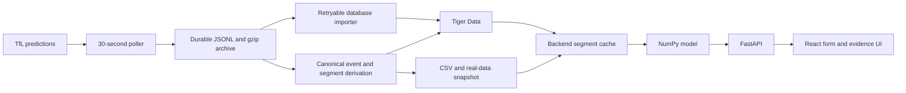

# DelayLens — Implementation Plan

> **When should I leave?** Use recorded London bus predictions to show an
> empirical journey-time distribution, its limitations and departure choices.

Rewritten 2026-10-24 after the ingestion review. This is the intended MVP, not a
report of completed implementation. See [progress](docs/PROGRESS.md) for verified
work and [the project brief](docs/PROJECT.md) for shared decisions.

**Contents:** 0 Tracks · 1 Priorities · 2 Scope · 3 Data · 4 Model · 5 Ask ·
6 Architecture · 7 Ownership · 8 Schedule · 9 Demo · 10 Risks, rules and sources

## 0. Tracks and judging

The initial team plan records opening-slide/schedule notes below. They remain
planning inputs: this rewrite does not independently verify organiser rules,
prize eligibility or submission requirements. M confirms those points.

| Target | Planned contribution |
| --- | --- |
| HRT — Data for Predictions & Decision Making (primary) | Real recordings -> empirical estimates -> understandable decisions; no claim of proven calibration |
| Tiger Data | Traceable time series and useful queries first; continuous aggregates and columnstore after the core works |
| Built with Delta | Role threads, reviewed output and collaboration links collected by M |
| Gemini API | Optional natural-language input grounded in our model; independent form fallback |
| Vultr (optional track) | Unattended recording and a supervised public demo |

Recorded judging weights: Speed & Performance 30%, Technical Implementation 25%,
Innovation 25%, Polish & Usability 20%. Fixtures are labelled during development;
they cannot substitute for real-data evidence in the judged product.

## 1. Priorities and cut rules

**Real recordings -> credible inferred segments -> model-readable handoff ->
working screen -> additional infrastructure and optimisation.**

1. Start TfL -> recoverable JSONL immediately. Database setup is not a gate.
2. Prove one short bus segment works; inspect five consecutive polls before
   locking its vehicle identity, direction and stop pattern.
3. Deliver manually checked samples, CSV/query contract and a real-data snapshot
   to M/B as soon as the first usable segments exist.
4. Connect model/API/UI with honest small-sample states, then add extras.

- After **90 minutes of continuous recording** without a manually checkable O->D
  segment, shorten/change the route. Preserve the archive and version the change.
- At Saturday 19:30, if the real-data journey is absent, cut Gemini, calibration,
  Tube and DB optimisation. Close the single-bus data/model/API/UI gap first.
- If support remains below the evidence thresholds, show insufficient/preliminary
  output. A recording demonstration alone does not meet the probability goal.
- Export the first snapshot at the **first usable-segment delivery**, not for the
  first time on Sunday morning.

## 2. Product scope

The MVP uses **London TfL bus data**. Oxford BODS is outside this version, not an
interchangeable second source. D/M/B use the same identifiers and contract; any
city/source change requires a shared plan/contract update first.

| Priority | Deliverable |
| --- | --- |
| P0 | One short bus segment, 30-second raw recording, traceable inference, CSV/query/snapshot handoff and ordinary database queries |
| P0 | Route/deadline/walking-time form, supported empirical distribution/curve, eligible advisor/what-if and a separate live-predictions panel |
| P0 | Usable sample counts, inferred-data labels, source dates/hours and insufficient/preliminary states |
| P1 | Supervised overnight VM, public demo and three essential recovery checks |
| P1 after core | Gemini, coverage UI, version-tested Tiger Data optimisation and properly labelled held-out evaluation |
| P2 | Tube, HSP sign-up/integration, longer 30-45-minute routes, full benchmarks, complex drills and live correction research |
| Out of scope | Arbitrary A-to-B, multi-leg journeys, accounts and unqualified calibrated-arrival guarantees |

Targets: a form result under two seconds, API p95 <300 ms and model work <50 ms
where feasible. Measure after correctness; these are goals, not existing results
or prerequisites for the first data handoff.

## 3. Data strategy

### 3.1 Short route first

D selects a frequent bus line and a **10-20-minute, 4-8 consecutive-stop** segment
on one unambiguous direction/pattern. Check duration against real recordings,
current service status and route sequence. Do not guess IDs or assume one branch.

Inspect five consecutive polls for identifiable vehicles progressing through that
pattern. Lock `route_id`, `line_id`, `direction`, `route_pattern_id`, ordered stop
IDs and `route_version`. Missing direction or ambiguous identity cannot produce
usable segments without further evidence. Exact IDs await D's live verification.
Tube and longer routes follow only after short-route samples/handoff work.

Concurrent D commit `ee055d6` records bus 29 (Finsbury Park to Tottenham Court
Road) and Victoria candidates, with route/status checks reported in its task
record. Those calls were not rerun here. Bus 29 still needs a short subsegment
and the five-poll identity check for this revised P0; Victoria remains P2. B/D
reconcile that configuration with this plan rather than discarding its evidence.

### 3.2 Capture before database

Poll `GET /Line/{lineIds}/Arrivals` every **30 seconds**. TfL describes a
30-second refresh for bus-arrival feeds; this does not prove every Unified API
response contains new observations. Check actual source timestamps, caching and
registered endpoint limits. See [TfL feed guidance](https://tfl.gov.uk/info-for/open-data-users/our-open-data).

Each request has a unique `poll_id`, collector identity, UTC `polled_at`, config
version, HTTP outcome and complete response payload. Durably append a recoverable
JSONL poll before database writes; maintain a gzipped archive. Preserve source
`timestamp` separately, full raw payloads before downstream stop filtering, and
available destination information for branch QA. Never log credential-bearing
URLs. Flush/rotation and truncated-tail recovery must be explicit; disk-write
failure is an error, not saved data.

A separate retryable importer/worker writes Tiger Data later; no message broker
is required. Raw capture and derivation from JSONL work before DB readiness.
Normalised predictions retain `vehicleId`, `naptanId`, `lineId`, `direction`,
`timeToStation`, `expectedArrival`, `timestamp`, provenance and pattern mapping.
Identical cached payloads do not create independent observations.

### 3.3 Conservative inferred events

TfL supplies **predictions**, not independent measurements of actual arrival.
Never rename `expectedArrival` to `actualArrival` or call inferred times ground
truth.

- Require a plausible ordered near-stop series reaching `timeToStation <= 60 s`,
  consistent timestamps and route progression. Initial heuristic: at least two
  distinct source predictions; repeated cached polls do not satisfy this check.
  D/M inspect raw examples before admitting this heuristic to the model.
- Use the last qualifying `expectedArrival` as an **inferred** time. Store
  `inference_method`, categorical `confidence`, `last_seen_at`,
  `prediction_count`, inferred time and raw-prediction/poll provenance.
- Early disappearance, stale/jumping forecasts, ambiguous branches/vehicle reuse
  and missing direction become uncertain/rejected evidence. Disappearance alone
  never creates a usable arrival event.
- Match `line_id + vehicle_id + direction + route_pattern_id` within a canonical
  vehicle run, with increasing `stop_sequence` and positive plausible duration.
  D/M agree route-specific duration bounds; ambiguous candidates are excluded.
- A 20-minute separation is an episode clue, not sufficient identity proof.
  Account for sequence resets and branch changes rather than merging by gap alone.

`confidence=high` means heuristic checks passed, not a calibrated probability of
correct inference. Quality labels/exclusion reasons survive every query/export.

### 3.4 Identity and replay

`poll_id` deduplicates re-import of the same saved poll, not two independent
collectors. Deduplicate repeated source predictions by documented source-field
identity; resolve canonical episodes on the merged stream. Stable event/segment
keys and uniqueness constraints with `ON CONFLICT` prevent repeat derivation.

D agrees the episode-key/reconciliation rule with B/M before handoff. Segment
identity includes route version and canonical run/endpoint events; it cannot be
a fresh UUID per derivation or depend on `collector_id`.

Use **one active derivation/database writer per route**. After VM handover, the
laptop is a raw backup rather than another independent live segment producer.
Replay overlapping logs through the same canonical path and verify unchanged
unique segment counts before accepting recovered samples.

### 3.5 Minimum segment handoff

This is a **format example, not collected evidence**:

```json
{
  "segment_id": "stable-unique-id",
  "route_id": "bus-example-A-B",
  "vehicle_id": "vehicle-123",
  "origin_at": "2026-10-24T17:10:00Z",
  "destination_at": "2026-10-24T17:24:30Z",
  "travel_seconds": 870,
  "inference_method": "near_stop_prediction",
  "quality": "estimated",
  "source": "tfl_live_recording"
}
```

CSV uses the same minimum fields. Times are inferred UTC timestamps and duration
is their difference. Full records retain `line_id`, `direction`, pattern/version,
`vehicle_run_id`, endpoint event IDs, confidence and a `segment_id` -> raw-record
lookup; snapshots retain that traceability. M uses only deduplicated estimated
segments passing both endpoint checks. Uncertain evidence is inspectable and
counted in exclusions, never silently added to the probability model.

### 3.6 Coverage, local time and early snapshots

Separate **poll completeness** (expected/successful/failed polls, gaps) from
**journey support** (usable run segments, vehicles, uncertain/rejected candidates,
represented hours). Prediction row count is not a journey count.

Store UTC. Derive Europe/London local date, weekday, UTC offset and repeated-hour
distinction. The two local 01:00 hours on Sunday 25 October remain separate;
Saturday and Sunday are not automatically interchangeable.

M/F choose a supported demo reference period early. Prefer explicitly dated
historical replay, e.g. an actually recorded Saturday-evening window. A Sunday
evening scenario using Saturday data is an explicit, unvalidated cross-day
assumption. Do not default to 14:00 when capture started later, silently pool
dates for more samples or relabel source recordings as another date.

Export the first real snapshot with the first usable segments; refresh it at
handoffs and before freeze. Include capture time, source dates/hours, route
version, quality/exclusion counts and provenance. B verifies loading without
Tiger Data; F labels snapshot mode separately from current TfL predictions.

## 4. Model and evidence policy (M)

Use NumPy empirical replay: for each departure add walk-to-stop and a documented
boarding buffer (initially one minute), find the next usable inferred origin
event and its paired destination, then add the final walk. Reference instants
use one-minute steps in a stated +/-30-minute local-time window. A +/-60-minute
expansion requires disclosed coverage and weekday/date-transfer assumptions.

Missing future vehicles at the recording edge or capture gaps are censored/
unsupported, not automatically late or successful trips. M defines eligible
reference intervals and reports excluded replay support.

`n_trips` counts distinct usable canonical run segments supporting the query,
not rows, replay steps or a vehicle ID assumed unique forever. Report distinct
vehicles and replay-step counts separately; overlapping subsegments of one run
cannot multiply the independent sample count.

| Usable runs | API evidence status | Behaviour |
| --- | --- | --- |
| 0-4 | `insufficient_data` | Real samples/counts only; no probability, interval or recommendation |
| 5-14 | `low_data` (UI: Preliminary estimate) | Descriptive empirical distribution with prominent warning; no risk-threshold departure recommendation; uncertainty may be null |
| 15+ | `ok` (empirical estimate) | Empirical curve and justified sampling band/departure choices; the count threshold does not establish calibration |

These are MVP display policies accepted in this review, not statistical proof.
M owns implementation and B/F coordinate contract/UI. At an eight-minute headway,
a 60-minute window may contain only about 7-8 runs; more overnight recording does
not necessarily fix the same-time-of-day limit.

Resample canonical trips or contiguous operating-time blocks, not minute query
points. If using 200 bootstrap resamples and a 90% band, label it conditional
sampling variability in this inferred dataset. It does not establish actual ETA
truth, cross-day validity or calibration. Default `calibration_status` is
`not_validated` until suitable held-out evidence exists.

The advisor chooses the latest eligible departure satisfying empirical P(late)
within tolerance; a conservative variant can use the lower band edge. Compute
up to 90 minutes of departures and client-side +5/+10/+15 comparisons, leaving
unsupported points unavailable. Suppress recommendations below 15 usable runs.

Calibration is P1 only with disjoint held-out runs/time blocks and a documented
reference standard. Scores against inferred events are labelled accordingly,
not actual-arrival validation. Live correction is P2 unless its reference/error
claims can be justified.

## 5. Ask DelayLens (B/F, after P0)

Retain Gemini as optional input parsing for supported route, deadline, walks and
tolerance. Function boundaries remain `list_routes`, `get_departure_curve`,
`compare_departures` and `get_live`; our model supplies numbers. Resolve ambiguous
dates/times explicitly, especially the clock change.

B validates arguments; F shows editable chips. Unsupported places list supported
routes. Three-second timeout -> prefilled form fallback. Keys stay server-side;
confirm current Google model/API against official docs during implementation.
Preserve evidence labels and insufficient/preliminary output. A templated answer
is sufficient; generative rephrasing is not a P0 requirement. Run about 20
phrasing/error cases if retained; hide Ask if it threatens the core form.

## 6. Architecture and interfaces



### 6.1 Files and ownership

| Owner | Planned files |
| --- | --- |
| D | `backend/ingest/poller.py`, `backend/ingest/derive.py`, `backend/sql/001_schema.sql`, `backend/config/routes.json`, `deploy/` |
| M | `backend/app/model.py`, `backend/tests/test_model.py`, calibration outputs, demo scenario, README and submission |
| B | `main.py`, `schemas.py`, `tfl.py`, `db.py`, `ask.py` under `backend/app/`; API tests/fixtures, `backend/pyproject.toml`, `backend/uv.lock`, `.env.example` |
| F | `frontend/`, demo images/video and table script |

B owns dependency/lockfile edits. D/B agree importer/helper/test paths before
adding them. Snapshot locations are agreed with B; credentials/raw archives stay
ignored. This document does not claim those planned files already exist.

### 6.2 Storage stages

P0 logical tables: raw poll/import identity, `arrival_predictions`, `stop_events`
and `segments`, with provenance and uniqueness constraints. Stop events include
`inference_method`, categorical `confidence`, `last_seen_at`, `prediction_count`
and `inferred_at`; this feed does not justify an `actual_arrival` field.

Use ordinary SQL for poll coverage and usable segment coverage initially. Add a
hypertable early only if it is a quick verified step, otherwise continue the
plain-table handoff. Record PostgreSQL/Timescale versions before applying DDL.

Continuous aggregates and Hypercore/columnstore follow the working data handoff.
Current Tiger Data docs distinguish `DISTINCT` inside an aggregate from query-level
`SELECT DISTINCT`; documented aggregate support includes 2.7-2.9, not only 2.10+.
Run the actual migration/query on the installed version. Do not assume legacy
compression syntax fits a current instance. Full benchmarks are P2. Sources are
linked in section 10.

### 6.3 API reconciliation (B)

Endpoint names stay below. Intended behaviour is not proof that application
schemas already implement the new nullable fields, metadata or thresholds. B
publishes fixtures and coordinates M/F before the Saturday 17:00 contract gate;
after freeze B approves and announces changes.

| Endpoint | Intended behaviour |
| --- | --- |
| `GET /api/routes` | Verified route/endpoints, actual usable coverage and source dates; any compatibility alias `trips_observed` explicitly counts inferred segments |
| `POST /api/departure-curve` | Route/deadline/walks/tolerance/window -> supported points, nullable interval/recommendation, comparisons and evidence metadata |
| `GET /api/live?route_id=...` | Current TfL predictions or `tfl_unavailable`; never present a snapshot as live |
| `GET /api/stats` | Separate poll/prediction/run-segment/vehicle/exclusion counts; optional optimisation stats may be unavailable |
| `GET /api/calibration` (P1) | Held-out results/reference standard or an explicit unavailable/not-validated state |
| `POST /api/ask` (P1) | Validated interpretation, model result and grounded answer with all evidence restrictions |

Retain `ok`, `low_data`, `insufficient_data` where possible: `low_data` now maps
to the 5-14 Preliminary estimate tier. B reconciles null/empty outputs for low
support/suppressed recommendations. Metadata includes usable run and vehicle
counts, inference/source, source dates/hours, pooling assumptions, snapshot
capture/mode where applicable and calibration status. Synthetic fixtures are
clearly labelled. No nullable/status change is silently assumed already merged.

### 6.4 Runtime and performance

Planned stack remains Python >=3.11, uv, FastAPI, NumPy, psycopg/httpx; React,
Vite/TypeScript with Node >=20/npm; Tiger Data/PostgreSQL; Vultr/Linux systemd.
B/F pin versions and publish actual setup/check commands when source/lockfiles
land. Local ports: API 8000, frontend 5173.

Config names: `TFL_APP_KEY`, `DATABASE_URL`, `GEMINI_API_KEY`, `POLL_LINE_IDS`,
`POLL_STOP_IDS`, `POLL_INTERVAL_SECONDS`, `RAW_BACKUP_DIR`, `FRONTEND_ORIGIN`.
B owns safe examples. Missing DB must not block raw capture; missing Gemini must
not block the form. B caches route segments, refreshing each minute. One request
returns the curve; slider/what-if work client-side. Measure latency with actual
environment, sample size and request mix after the real-data slice works.

## 7. Team and ownership

| Code | Responsibility | Branch | Task record |
| --- | --- | --- | --- |
| D — Jintian-JTST | Collection, inference, schema/routes, snapshots and infra | `feat/data` | [data-ingestion](tasks/data-ingestion.md) |
| M — person not recorded | Model, evaluation, scenario, README and Devpost | `feat/model` | `tasks/model.md` — owner to create |
| B — person not recorded | API/fixtures, Gemini, caching, shared docs and integration | `feat/api` | `tasks/backend-api.md` — owner to create |
| F — person not recorded | Frontend, evidence UI, pitch and video | `feat/frontend` | `tasks/frontend-demo.md` — owner to create |

One owner per file; shared interfaces go through B. This owner-requested review
revision synchronises shared documentation; B maintains summaries/contracts in
subsequent integration. No teammates' application files change in this revision.
Use separate worktrees/clones for concurrent work; task records are under
`tasks/` using [the template](tasks/TEMPLATE.md).

B integrates D -> M -> B -> F in small handoffs. Fixtures remain labelled; real
integration is a separate gate. If blocked over 20 minutes, report in the role's
Delta thread and tell B. Planned threads remain D data / M model / B API / F
frontend plus ideation and contract; M collects links. This rewrite itself does
not send messages or create those threads.

This documentation revision uses `codex/revise-ingestion-plan`, independently of
the ongoing `feat/data` implementation. B preserves the concurrent D evidence
when integrating and consolidates its legacy task record into the canonical
`tasks/data-ingestion.md` rather than maintaining competing task records.

## 8. Schedule and gates

Times use **Europe/London**, Saturday 24 to Sunday 25 October. Original kickoff
14:00 and recorder 15:00 are targets, not completion claims. If starting late,
begin G0 now; use elapsed capture time for the 90-minute cut and preserve Sunday's
deadline.

| Gate / target | D | M / B / F and exit condition |
| --- | --- | --- |
| G0 immediately; original Sat 15:00 | Check five polls, short bus pattern and durable full JSONL | M specifies inputs; B/F use labelled fixtures. Exit: real capture independent of DB. |
| G1 first 90 minutes | Initialise DB/import when available; inspect inferred O->D | No credible segment -> shorten/change route. Exit: traceable sample or explicit route cut. |
| G2 first usable segments | Deliver CSV, query/schema/quality contract and first snapshot | M reads CSV; B reads same segments and tests snapshot without DB immediately. |
| Sat 17:00 contract gate | Agree identity/route/quality fields with B/M | B publishes revised schemas/fixtures; M/F acknowledge tiers/nullability. Unresolved changes stay explicit. |
| Sat 18:30 handoff | Refresh samples, queries, coverage/exclusions and snapshot | M/B connect real model/cache; M/F pick genuinely covered scenario time. |
| Sat 19:30 core gate | Diagnose matching/data gaps | Real data -> model -> API -> screen; apply cuts if absent. A fixture is not a pass. |
| Evening, target Sat 21:30 | Supervised VM; one active writer | Prove restart, DB-down raw saving and idempotent replay before unattended use. |
| Sat 21:30-23:00 after core | Ordinary coverage/stats, then optional optimisation; deploy B/F packages | Verify public form, evidence states/live panel and deployed revision; Ask optional. |
| Sat 23:45 overnight gate | Recorder/disk/raw backup and snapshot refreshed | Unattended collection confirmed; team sleep target 00:00-07:00. |
| Sun 07:00-08:30 | Gaps/clock-change QA; recover and refresh snapshot | M checks support/evaluation; B/F verify real/low-data/unavailable states. |
| Sun 08:30-09:30 | Final redeploy support, latency measurement, hotspot if time | Lock supported demo scenario and optional cuts; feature freeze 09:30. |
| Sun 09:30-10:30 | Data/infra notes to M by 10:00; VM/recorder/snapshot check | M submission draft; B endpoints; F backup video/script. |
| Sun 10:30-11:15 | Support rehearsal/fixes | Under-three-minute rehearsal; M targets submission 11:00-11:15 with confirmation. |
| Sun 11:15-12:00 | Only B-approved demo-breaking redeploys | Verify submission; hacking ends 12:00. |

Inherited event notes: dinner Sat 18:00-19:00, breakfast Sun 08:00-09:00,
Devpost workshop Sun 09:00-10:00 (M), judging 13:00-15:45, closing 16:00. M
confirms exact submission rules. Judging rota retained: all four 13:00-13:45;
F/M/D 13:45-14:30; F/M/B 14:30-15:15; all four 15:15-15:45. F presents with a
technical answerer present.

## 9. Demo and fallback

1. Show actual route/reference date/time, coverage, usable count and inferred
   evidence limitation before quoting probabilities.
2. Show form, empirical curve and eligible advisor/what-if. With 5-14 runs show
   Preliminary estimate and no risk-based recommendation; below five show real
   samples and explain the unmet prediction target.
3. Show current TfL predictions separately from the historical replay.
4. If retained, Ask selects the same supported scenario. Do not hard-code a
   14:00 example without evidence for that reference period.
5. Trace raw evidence -> inferred segment; show separate poll/journey counts.
   Add optimisation/evaluation evidence only when implemented and checked.

Fallback: refreshed real snapshot through B's API, then F's video. Snapshot mode
needs no Tiger Data, but still needs a local/hosted API unless an offline bundle
is separately verified. Keep live data unavailable/stale explicitly labelled.
Test the first snapshot at G2; never substitute synthetic judged probabilities.

## 10. Risks, rules and sources

| Risk | Response |
| --- | --- |
| Disappearance or ambiguous identity | Keep uncertain evidence, exclude mismatches and preserve raw provenance |
| Too few runs / long segment fails | Short route, 90-minute cut and evidence tiers |
| DB unavailable | Raw saving continues; retry import; CSV/snapshot handoff proceeds |
| Duplicate backups | One canonical writer; stable keys and overlap/replay count checks |
| Clock change / date transfer | UTC plus local date/offset/fold; explicit supported replay/transfer assumption |
| Overnight process exit | Prove systemd restart before absence; laptop raw backup |
| Optional work delays core | Defer Tube/HSP, benchmarks, complex drills, Gemini and optimisation as needed |

Initial notes record teams <=4, MLH/Hackathons UK conduct rules, hacking Sat 12:00
-> Sun 12:00 and Devpost/table judging. M confirms exact fields/cut-off,
multi-prize eligibility, pre-existing-code/AI-use rules and attribution before
representing them as settled requirements.

Technical sources checked 2026-10-24:

- [TfL feeds](https://tfl.gov.uk/info-for/open-data-users/our-open-data): bus-feed refresh, prediction semantics and feed-specific attribution. The bus guidance says "Data provided by Transport for London"; M/F verify applicable terms rather than assuming the earlier proposed footer suffices.
- [TfL API portal](https://api-portal.tfl.gov.uk/): current registration/access documentation; verify endpoint limits during setup.
- [Tiger Data continuous aggregates](https://www.tigerdata.com/docs/build/tips-and-tricks/troubleshoot-continuous-aggregates): version-dependent query/aggregate support.
- [Tiger Data Hypercore](https://www.tigerdata.com/docs/learn/columnar-storage/understand-hypercore): rowstore/columnstore behaviour; our instance migration remains untested.

The owner supplied the review in chat and a [shared copy](https://chatgpt.com/share/6adcb335-0514-83eb-977c-0a7678ce4b3b).
The shared page could not be fetched; this rewrite uses the pasted review, not
assumed extra content. No live collection, migration or deployment is established
by this documentation revision.
